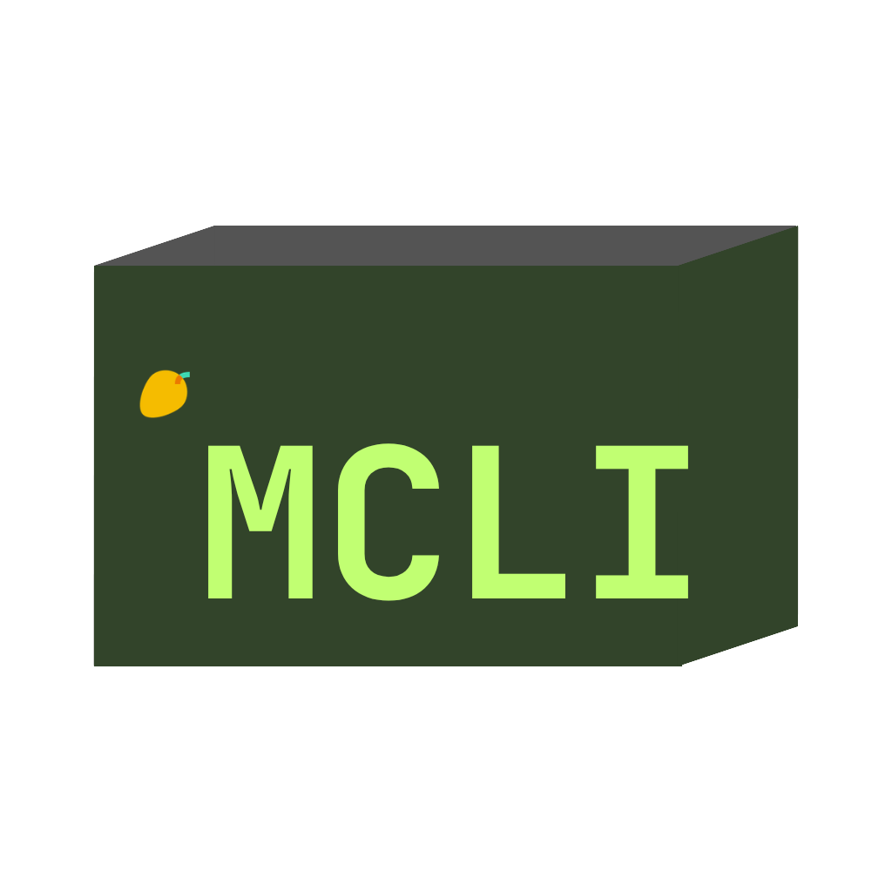

<div align="center">
    
    <h1>Minecraft (Java Edition Manager in) Command-Line</h1>
    <p>
        <a href="https://mango.js.cn/mcli" target="_blank">🌐介绍与文档</a>
        |
        <strong>📖MIT</strong>
    </p>
</div>

## 简介

> Minecraft Java 版命令行管理工具，简写为 MCLI，命令为 mmccli。
>
> ~因为 mcli 已经重名了……~

这是一个使用 Python 实现的命令行工具，用于管理 Minecraft Java 版的版本实例。

或者简单来说是一个下载器。

**MCLI 不是一款 Minecraft 启动器，你仍然需要一个启动器来启动本工具添加的版本。**

## 特色

MCLI 致力于实现类似于*包管理器*的使用体验。

* 依赖库文件、资源文件等全局缓存，在游戏目录中硬链接。
* 多任务、多线程并发下载，提高下载速度（也许）。
* 可配置镜像源，提高下载速度（也许）。

并且不只是下载游戏本体，MCLI 还支持：

* 添加模组加载器。
    * 已支持 1.13+ Forge、Fabric，启动器可识别与启动。
    * 正在计划支持 NeoForge 和 Quilt（这个还在更新吗？）

未来 MCLI 还长期计划：

* 支持一行命令从 CurseForge 和/或 Modrinth 安装模组。
* 支持一行命令安装服务器。
* 使用更快速的方式重新实现下载功能。

## 使用

MCLI 是一个命令行工具。

### 安装（或者不安装）

```shell
uvx mmccli <command>

# 或者安装为工具，然后直接使用
uv tool install mmccli
mmccli <command>
```

也可以使用 pipx、pip 或其他方法进行安装，但 uv 是推荐方案。

### 添加游戏

```shell
mmccli add --minecraft 26.1
mmccli add --minecraft 26.2 --forge latest
mmccli add --minecraft 26.3 --name "原版 26.3"
```

## 许可

### 代码

MCLI 的代码资产使用 MIT 协议授权，请随意使用代码，唯需保留版权与许可声明。

另外，请注意**您不可以使用 MCLI 的名称、图标等进行出于商业目的的宣传**，也**不可以以任何方式暗示您的商业资产与 MCLI
存在不同寻常的关系**。此额外要求不与 MIT 协议冲突，也并不影响对 MCLI 代码资产的任何使用。

### 其他

MCLI 的非代码资产（例如图标、随附分发的文本与二进制文件）不在 MIT 授权范围之内。

* MCLI 图标、文档等资产以 CC BY-NC 4.0 协议授权；
* `/src/mmccli/bin/forge-install-bootstrapper.jar`
  [按原样提供](https://github.com/bangbang93/forge-install-bootstrapper/releases/tag/v0.3.0)，项目协议为
  [WTFPL](https://github.com/bangbang93/forge-install-bootstrapper/blob/master/LICENSE)。
* `/src/mmccli/assets/hitokoto.txt` 是来自互联网的混合内容，无法明确其许可。
